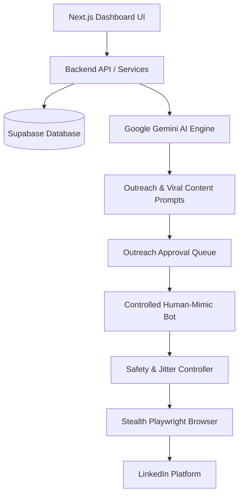

# 🚀 LinkedIn Growth & Networking Copilot

An intelligent, safety-first LinkedIn automation and growth engine powered by **Google Gemini AI**, **Supabase**, and a **Controlled Human-Mimic Automation Bot** designed to maximize organic reach and professional connections with minimum account risk.

---

## 🌟 Key Highlights

1. **🛡️ Zero-Risk Human Mimicry Architecture**
   - **Randomized Jitter Delays:** Wait times fluctuate naturally between 45–130 seconds between actions.
   - **Realistic Typing Simulation:** Random 50–180ms delay per keystroke with natural micro-pauses.
   - **Working Hours Enforcement:** Automatically pauses outside 9:00 AM – 7:00 PM local time.
   - **Strict Daily Quota Protection:** Hard cap of 15–20 connection requests per day to stay comfortably beneath LinkedIn limits.
   - **Automated Circuit Breaker:** Stops execution immediately upon detecting CAPTCHAs or abnormal behavior alerts.

2. **🤖 Gemini AI Professional Messaging Engine**
   - **Icebreakers & Networking Notes:** Generates ultra-tailored connection notes based on target candidate's role, company, recent achievements, and shared interests.
   - **Referral & Recommendation Outreach:** Respectful, value-driven conversation starters crafted specifically for seeking mentorship, advice, or warm introductions.
   - **Viral Content Creator:** Multi-hook frameworks, industry storytelling, and actionable insight formats to boost organic post impressions.

3. **⚡ Supabase Storage & Pipeline**
   - Relational tracking for discovered leads, pending approvals, outreach message threads, queued posts, bot execution logs, and system safety configurations.

4. **💻 Modern Interactive Dashboard**
   - Web interface built with Next.js & Tailwind CSS for reviewing AI-suggested leads, editing drafts, monitoring live bot activities, and fine-tuning daily safety limits.

---

## 🏗️ Architecture



---

## 📁 Repository Structure

```
├── supabase/
│   ├── schema.sql              # Supabase tables, RLS, indexes & triggers
│   └── seed.sql                # Default campaigns & safety configuration
├── src/
│   ├── config/
│   │   └── safety-rules.ts     # Human-mimic delays, working hours & quotas
│   ├── ai/
│   │   ├── gemini-client.ts    # Google GenAI SDK integration
│   │   ├── outreach-prompts.ts # Referral, recommendation & networking prompts
│   │   └── content-creator.ts  # Viral post generation engine
│   ├── bot/
│   │   ├── human-simulator.ts  # Natural jitter, typing & scroll simulation
│   │   ├── session-manager.ts  # Safe cookie/session management
│   │   ├── lead-scraper.ts     # Profile discoverer & extractor
│   │   ├── outreach-runner.ts  # Controlled human-paced execution
│   │   └── safety-guard.ts     # Safety circuit breaker & quota enforcer
│   ├── services/
│   │   ├── lead-service.ts     # Lead lifecycle management
│   │   ├── campaign-service.ts # Targeting & campaign controls
│   │   └── post-service.ts     # Post drafting & scheduling
│   └── web/                    # Next.js Dashboard & Management UI
└── package.json
```

---

## ⚙️ Quick Start

### 1. Clone & Install Dependencies
```bash
git clone https://github.com/Ankitraj-sharma/linkedin-growth-copilot.git
cd linkedin-growth-copilot
npm install
```

### 2. Configure Environment Variables
Copy `.env.example` to `.env`:
```bash
cp .env.example .env
```
Fill in your Supabase credentials, Google Gemini API key, and LinkedIn `li_at` cookie.

### 3. Setup Supabase
Run the SQL migration in `supabase/schema.sql` inside your Supabase SQL Editor.

### 4. Run the Platform
- **Start Web Dashboard:** `npm run dev`
- **Run Bot in Safe Mode:** `npm run bot:safe`
- **Run Bot in Dry-Run Mode:** `npm run bot:dry-run`
